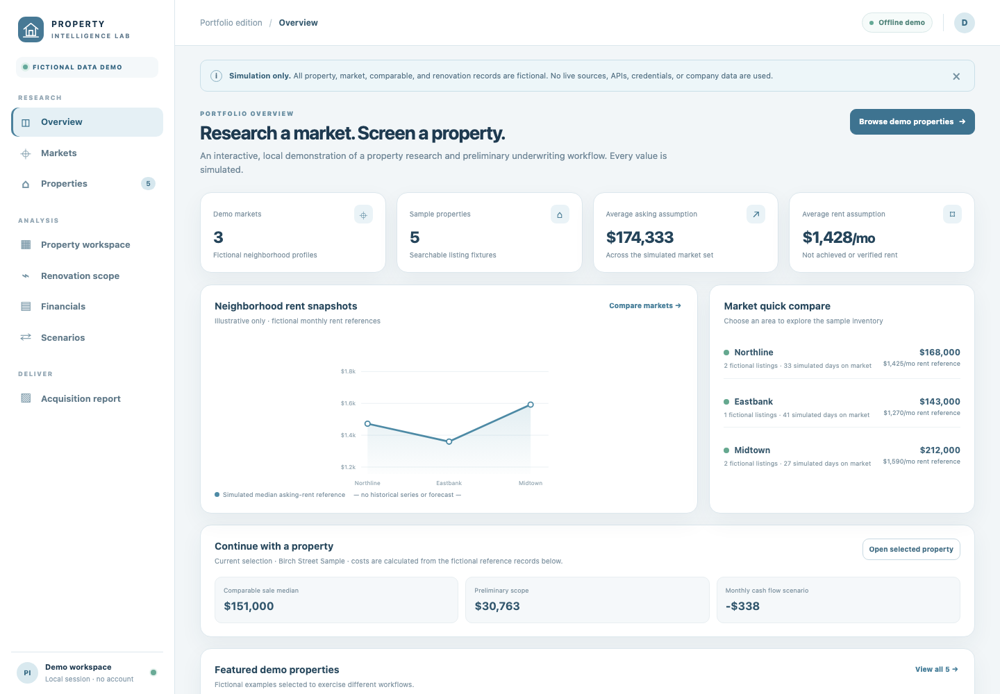
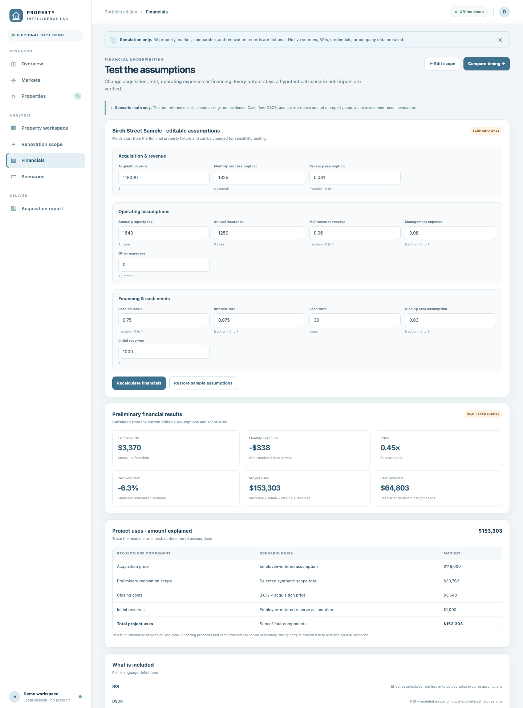

# Property Underwriting Intelligence

**An interactive property-research portfolio demo, with a reproducible Python underwriting pipeline.**

Real-estate screening combines incomplete property facts, renovation needs, comparable sales, rent assumptions, and financing terms. This project demonstrates one way to keep those inputs traceable, compare scenarios, and make unsupported conclusions visible.

The public edition now has two connected demonstrations:

- A local website for fictional market research, sample-property discovery, comp review, editable renovation scopes, financial scenarios, construction-timing comparison, and a print-ready acquisition report.
- A Python seven-engine pipeline showing structured evidence handling, scope coverage, sales/rental analysis, financial calculations, and decision readiness.

Everything in the public demo is simulated. It is not the private Roof4All application, a live address lookup service, an appraisal, or an investment recommendation.

## Try the website

Requires Python 3.11 or newer. The interactive portfolio app uses only the Python standard library and makes no external requests.

```bash
python3 -m portfolio_demo.server --port 8790
```

Open [http://127.0.0.1:8790](http://127.0.0.1:8790). Stop it with `Ctrl-C`.

The demo flow is:

1. Compare fictional markets and browse fictional listings.
2. Open a property workspace with made-up facts, comparable sales, and asking-rent examples.
3. Generate a preliminary itemized scope, inspect its synthetic analog counts, and edit budget amounts.
4. Change financing and operating assumptions to recalculate NOI, DSCR, monthly cash flow, and cash-on-cash.
5. Compare four- and six-week construction scenarios, then print the report or save it as PDF from the browser.

The interface was authored for this public demo. It uses a familiar research-to-underwriting workflow without private logos, images, company policy, or internal application code.





[Open the two-page sample acquisition report (fictional data)](docs/portfolio_report_sample.pdf)

## What the analytical example demonstrates

### Renovation estimate from case-based analogs

The website's independent Python estimator uses **six fictional project records**. It ranks examples using explicit feature weights—market 30%, property type 15%, construction era 15%, living area 25%, and basement 15%—then estimates each selected work package with a similarity-weighted mean. Flooring, paint, and basement-finish packages use fictional per-square-foot rates; other items use fictional project packages.

Each generated line retains its low/base/high values, supporting-record count, evidence label, and calculation method. The displayed low/high values are the observed minimum and maximum among selected synthetic analogs. They are not confidence intervals. A chosen scope strategy determines which categories are included; the app never claims that the work was observed or is required at a real property.

The estimate remains editable so a reviewer can test budget sensitivity. It is labeled `SYNTHETIC_SCENARIO_ONLY` and contractor review is required before any real-world use.

### Data preparation and holdout evaluation

The demo includes a reproducible preparation step that validates IDs and numeric fields, rejects conflicting duplicates and unknown market references, and joins fictional properties to market names and comp counts. The exact transformations and tests are documented in [synthetic data preparation and model evaluation](docs/synthetic_data_and_model_evaluation.md).

The same page explains the property-level leave-one-out method and reports results for six fictional projects. On this tiny synthetic fixture, mean absolute error across tracked component costs is $911.66, and mean absolute percentage error across tracked-component sums is 15.00%. Basement-finish work is excluded because the fixture lacks basement-area quantities. **These are method-demo results only; they are not Roof4All performance, contractor-cost accuracy, or real-world validation.** Reproduce the output with:

```bash
python -m portfolio_demo.evaluation
```

### Financial and timing sensitivity

The scenario calculator exposes purchase price, rent, vacancy, operating expenses, leverage, rate, term, closing costs, and reserves. It calculates gross rent, NOI, debt service, DSCR, monthly cash flow, project uses, and stabilized annualized cash-on-cash from those explicit inputs.

Construction timing compares four and six weeks while holding the selected scenario constant. Repair duration rounds up to full months; rent is withheld during repair and lease-up; a separate carry assumption increases project uses. The output distinguishes first-year operating cash flow from stabilized annualized cash-on-cash.

These are deterministic calculations on fictional assumptions, not a construction-duration forecast or model of actual Roof4All projects.

### Reproducible tests

The portfolio-demo tests check fictional-data labeling, preparation joins and data-quality failures, analog weights, property-level holdouts, project-use reconciliation, editable-scope propagation, financial recalculation, timing sensitivity, and invalid-input handling. The existing public pipeline tests cover evidence admission, source conflicts, comp de-duplication, scope overlap, abstention, and scenario isolation.

```bash
python3 -m unittest discover -s tests -v
```

For the seven-engine CLI and its Pydantic dependency, install the package in a virtual environment:

```bash
python3 -m venv .venv
source .venv/bin/activate
python -m pip install .
python -m pip check
python -m unittest discover -s tests -v
underwrite-demo
underwrite-demo --case insufficient
underwrite-demo --case identity-conflict --json
python examples/run_financial_demo.py
python examples/run_timing_sensitivity.py
```

See the [clean-install and validation record](docs/validation.md) for the tested Python version, dependency versions, and known validation limits. GitHub Actions is configured for Python 3.11–3.13; configured CI is not proof of a hosted run.

## The seven-engine Python pipeline

```text
Property/data trust → Condition → Renovation scope
          │                │              │
          └────────────────┴──────────────┤
                                         ↓
                              Comparable sales / ARV
                                         ↓
                                  Rent / HCV
                                         ↓
                                  Financials
                                         ↓
                               Decision readiness
```

The pipeline executes all seven stages on explicitly synthetic fixtures. It preserves source observations and conflict states, separates asking rent from achieved rent and HCV references, prevents duplicate comp/scope contributions, and keeps scenario values out of evidence-backed conclusions. Readiness blockers identify missing review steps; the demo does not approve an acquisition.

The CLI is a software-behavior demonstration, not a trained nationwide prediction service. It does not contain the private historical contractor dataset or realized construction outcomes. Its synthetic values and tests cannot substantiate real-world property-value, rent, or renovation-cost accuracy.

## Example CLI behavior

```text
1. PROPERTY_DATA      PARTIAL
2. CONDITION          PARTIAL
3. REHAB              PARTIAL
4. VALUATION          READY
5. RENT_HCV           PARTIAL
6. FINANCIALS         INSUFFICIENT
7. DECISION           DUE_DILIGENCE_REQUIRED

Scenario NOI:          $8,207.50 [SCENARIO_ONLY]
Scenario DSCR:         1.22 [SCENARIO_ONLY]
Monthly cash flow:       $124.59 [SCENARIO_ONLY]
Acquisition approval:  DISABLED
```

The full output is in [docs/demo_report.txt](docs/demo_report.txt). `READY` for a synthetic valuation fixture means only that the fixture passes the configured support rules; it is not a verified real-property value. The $2,000 fictional rehab subset is not treated as a complete budget.

## Boundaries and data provenance

- All web-app properties, markets, sales, rental records, project analogs, and their dollar amounts are fictional fixtures created for the portfolio demonstration.
- No live source, address lookup, API, provider credential, company database, historical contractor document, or property photo is used.
- Provider adapters and private historical source data are not included.
- Synthetic metrics are not measured market performance and are not trained predictions.
- A provider AVM, asking rent, scenario return, or payment standard is not a verified appraisal, achieved rent, approved contract rent, or investment outcome.
- Unknown expenses and hidden repair needs are not silently treated as zero.
- Report output is a preliminary scenario summary, not a lender-certified Scope of Work or contractor quote.

## Publication and licensing status

The interactive demo and seven-engine pipeline are published on the repository's `main` branch in commit [`599d352`](https://github.com/elijahchiu/property-underwriting-intelligence/commit/599d352f282c129fc92aa004f1cfa4b3c5246235). The website is source code in this repository, not a hosted public service: run the command above locally to use it. The demo is independently authored and excludes the private Roof4All logo, assets, data, policy, provider adapters, and application code. No open-source license is included, so reuse remains subject to the repository owner's permission and any applicable company rights.

## Further reading

- [Architecture and extraction notes](docs/architecture.md)
- [Synthetic timing sensitivity output and formulas](docs/timing_sensitivity_report.txt)
- [Validation results and clean-install record](docs/validation.md)
- [Seven-engine sample report](docs/demo_report.txt)
